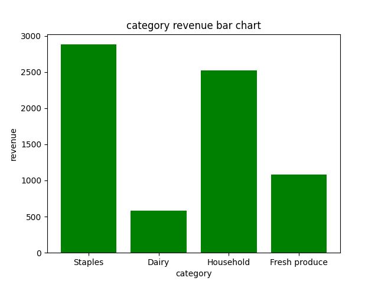
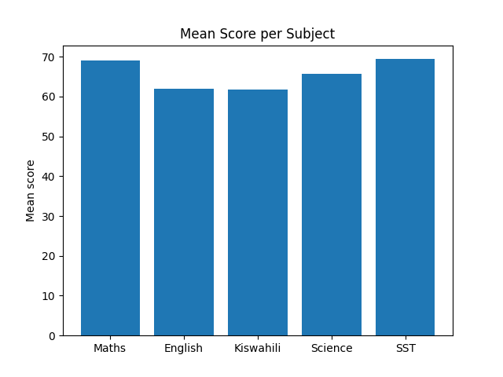

# Python Data Visualization Practice

## Overview

This repository contains my Python data visualization practice using Matplotlib. I created two bar charts to practice presenting data clearly and communicating insights.

## Chart 1: Supermarket Category Revenue

**Key observations**

* Staples has the highest revenue in the chart.
* Household is the second-highest category.
* Dairy has the lowest revenue.

## Chart 2: Mean Score per Subject

**Key observations**

* Mathematics and SST have the highest mean scores.
* English and Kiswahili have the lowest mean scores.
* Science performs between the higher- and lower-scoring subjects.

## Tools Used

* Python
* Matplotlib
* Data visualization

## Learning Objectives

* Create bar charts.
* Add chart titles and axis labels.
* Compare values across categories.
* Communicate findings using visualizations.

This repository is part of my ongoing journey in Python and data analysis. The charts are practice exercises, and the observations are based on the values displayed.

